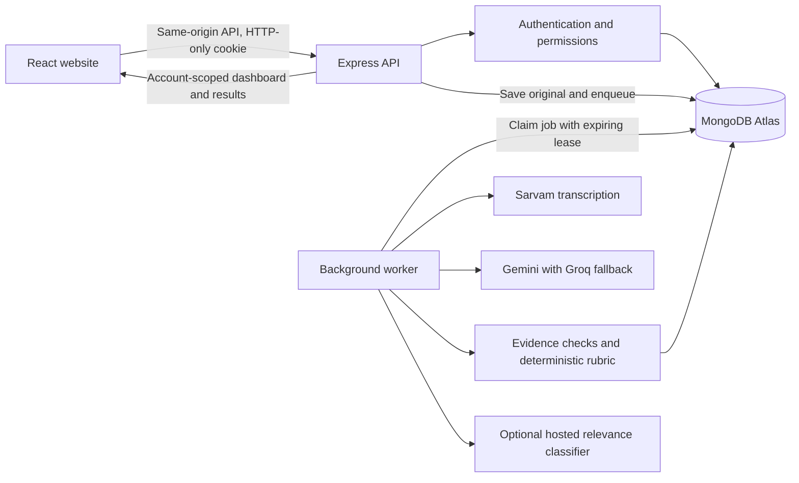

# STRIVE system design

The application uses a modular MERN service with a durable background worker. The React website, Express API, Atlas storage and hosted AI providers have separate responsibilities. Run one API process for this hackathon configuration; request spacing and authentication rate-limit counters are per process.

## Authentication and session lifecycle

- Public registration always creates an entrepreneur. Programme bootstrap explicitly creates the assessor role; client input cannot grant that role.
- Passwords are bcrypt hashes. A successful sign-in generates a new 256-bit random session token, stores only its HMAC digest in Atlas, and revokes the previous cookie's session.
- Cookies use HTTP-only, SameSite Strict and a root path; Secure is enabled in production. Absolute session expiry is eight hours. Every authenticated request checks expiry and the user's persisted role; it does not rely on MongoDB's eventual TTL cleanup.
- Header **Sign out** is visible on desktop and mobile. Settings also provides browser-only sign-out, all-device sign-out and password changes. Single-browser sign-out removes that session; repeated sign-out is safe.
- All-device sign-out atomically increments the account's session version. The server rejects every older session version, including sessions saved late by a racing sign-in. Old session cleanup is best effort; version checks enforce revocation immediately.
- Password changes require the current password, validate the new password with the shared schema, compare the previously read password hash during the update, and increment the session version in the same account update. All older sessions become invalid; the user signs in again.
- Sign-out is confirmed only after the server accepts revocation. If storage is unavailable, the UI reports failure and offers retry. It does not claim that the server session was revoked.
- Other tabs receive a storage event containing only an event type and random nonce. No passwords, session tokens, profiles or submissions go into browser storage. Sign-out clears their private workspace data; account changes trigger revalidation. If storage is unavailable, server-side revocation still works and other tabs discover it on their next request.
- The browser ignores unauthorized responses from an earlier authentication generation. Dashboard request revisions prevent pre-logout responses from repopulating the workspace. Expired/revoked sessions return to sign-in with an explanation.

## Authorization and data isolation

Authentication answers who the caller is; authorization decides which records and actions they may access. The API reads the role from Atlas on requests and scopes entrepreneur queries by the server's account ID. Supplied owner IDs cannot expand access.

Entrepreneurs can read their own submissions, originals, scores, statistics and clarification sources. Cohort administration, comparisons, similarity results, annotations and assessor decisions require the assessor role. Dashboard aggregation applies the ownership match before any aggregate calculation. Private dashboards never load synthetic example records.

Assessor decision support is computed from the current, source-validated assessment through an assessor-only endpoint. It does not mutate the assessment score or use an LLM. Financial rule contributions, coverage and missing values are explicit; the financial risk index is not a calibrated failure probability. Nearby listings are requested separately after place/category confirmation and never affect that index. Server-whitelisted OSM category filters, coordinate/radius validation, bounded results, caching and two bounded public-service attempts protect the map lookup. Incomplete provider results return an error rather than appearing as an empty market. Entrepreneurs do not fetch or receive either assessor decision support or the map lookup endpoints.

Passwords and roles use strict shared input schemas. SameSite cookies, Origin checks and cross-site Fetch Metadata rejection protect browser mutations. Sign-in, registration, writes and password changes have bounded request rates. API responses use `Cache-Control: no-store`; access checks still apply after browser back navigation.

## Consistency and background work

The original is saved before processing. Jobs live in Atlas and claim an expiring lease with a unique token. Heartbeats extend the lease; only the current lease holder may finish the job. This is recoverable, at-least-once processing—not a claim of exactly-once provider calls.

Validated transcription, source reading and extraction have source/model-bound checkpoints. Retries reuse those checkpoints. Source changes invalidate them. Provider timeouts, bounded retries, exponential backoff, separate cooldowns and Gemini-to-Groq fallback prevent unbounded request loops. Quota reset times persist in Atlas. A model failure never creates invented vectors, facts or scores.

Assessment revisions and reviews use version checks to reject stale writes. Exact quotations and cited source IDs are checked before supported facts can contribute to the deterministic rubric. The optional trained relevance classifier stays advisory and runs only on a hosted endpoint.

One shared deterministic question bank covers all 19 parameters. The server derives pending questions from unsupported, missing or unclear fields rather than letting a model choose questions or limiting the list to three. Serialization expands old stored question lists without rewriting historical assessments or rerunning provider calls. The clarification endpoint uses the same eligibility rule, rejects changes to already supported fields and requires the current assessment version. Short answers retain the question as interpretation context, never as quoted answer evidence. Only a source-validated replacement changes the selected field; previous facts, originals and assessment history are retained. The form then advances to the remaining parameters.

## Operations and shutdown

Every response receives a server-generated `X-Request-ID`; errors handled centrally also include it in JSON. Internal API errors log the identifier and a safe category, without passwords, tokens, input bodies or provider response bodies. Duplicate-key errors have a safe client message.

`GET /api/health/live` reports that the API can respond. `GET /api/health/ready` returns HTTP 503 while Atlas is disconnected. `GET /api/health` retains the UI's configuration indicators; a configured provider key is not proof of available quota.

The HTTP listener starts while Atlas connects. Initial connection or initialization failures retry serially with exponential delays capped at 30 seconds, logging safe failure categories rather than connection strings or raw errors. Worker initialization follows a successful connection; shutdown cancels scheduled retries and drains an in-flight attempt. After successful initialization the MongoDB driver handles topology reconnection. Signed-out pages poll availability every 10 seconds while the database is unavailable and the page is visible, and offer a manual connection check that preserves form input.

SIGINT and SIGTERM stop new job claims, close the HTTP listener and allow accepted requests/jobs up to 15 seconds to drain before disconnecting Atlas. The process has a 20-second hard exit deadline. Interrupted jobs retain their checkpoints and recover after their leases expire; a long external call may need to be repeated. Test-mode startup disables Atlas and the worker so browser checks cannot accidentally process participant submissions.

`npm.cmd run dev` uses `concurrently --kill-others`. The frontend command waits up to 90 seconds for API liveness before launching Vite. Both the proxy and the startup check derive the API target from the same port-validation helper. A root server `.env` is parsed for the proxy port without applying its development NODE_ENV to production client builds. Ctrl+C stops the group; if one command exits, the other is stopped too. Failed session requests trigger automatic availability polling even if no session response has ever succeeded, and the account screens distinguish API failure from an unavailable database.

## Scaling boundaries

The present design supports a small single-process programme workspace. For multiple API instances, move rate-limit and request-spacing state into a shared store and run workers independently with shared provider budgets. Keep Atlas indexes for ownership, queue claims and session lookups. Add external monitoring, backups and recovery exercises before relying on the app operationally. These are future deployment concerns; no such infrastructure is claimed to be configured here.

Implementation checks cover role/record isolation, cookie rotation, expiry/version revocation, cross-site mutation rejection, failed logout, cross-tab cleanup, password change and bounded shutdown. No live trained-model inference is needed for those checks.

Design references: [OWASP session management](https://cheatsheetseries.owasp.org/cheatsheets/Session_Management_Cheat_Sheet.html) and [MDN storage events](https://developer.mozilla.org/en-US/docs/Web/API/Window/storage_event).
