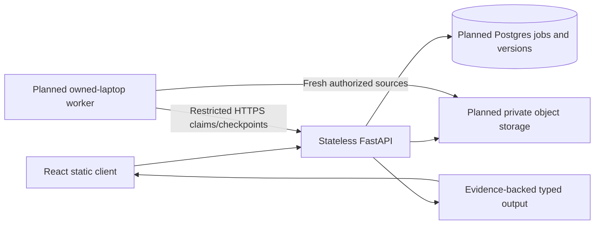

# Architecture and versioned contracts

Implemented at T03: static frontend/API foundation, Pydantic schema catalog, generated client types, provider interfaces and deterministic rubric arithmetic. Database/auth/durable workers/model integration are subsequent tasks; this document does not claim they exist yet.

## Contract source of truth

`apps/api/app/contracts/models.py` defines schema-v1 field states, language provenance, text/PDF/audio evidence, structured facts, strict ratings, score summaries, assessments, submissions, job states, fenced stage claims, reviews and clarifications. Pydantic forbids extra fields. Present facts need values/evidence; unresolved fields retain nulls. Alternatives preserve ambiguity. Evidence carries submission/revision identity; assessment validation rejects unknown/duplicate/cross-submission references. Page coordinates are normalized and audio/character ranges ordered; actual source-length/duration authorization is additionally enforced by later resource/pipeline boundaries.

The live schema catalog is built by `contracts/schema.py`; `scripts/export_openapi.py` emits the same catalog. `openapi-typescript` generates `apps/web/src/api/generated/schema.ts`. Generated files are checked in; do not edit them by hand. When routes are added, regenerate and review breaking changes. No feature endpoint is fabricated merely to include an unused contract in OpenAPI.

Canonical business facts omit beneficiary identity/demographics. Location is approximate until confirmed; a PIN is not an exact coordinate. Additional technical questions remain evidence-linked facts. Money preserves amount/currency/period/unit; unknown currency or period remains explicit. The server computes totals from ratings; a model never supplies authoritative final arithmetic.

## Boundaries introduced next

API routes authorize each submission/attachment/job/evidence/report/similarity/aggregate boundary. Private storage keeps intact originals; Postgres stores revisions, evidence, stage leases and publication keys. A monotonically increasing claim generation fences stale workers. Owned model code receives restricted capabilities, not unrestricted database credentials. URLs are issued after a successful claim and can be renewed after bounded queue delays. Jobs are resumable; free service sleep does not create an always-on scheduler.

Provider protocols separate extraction, translation, assessment and embeddings. Implementations must preserve unknowns and provenance, bound output/repair and expose unavailable states. A deterministic fixture proves orchestration/contracts only; actual self-hosted inference is separately verified. Local model execution has no provider allowance but does depend on hardware/network uptime. HF is an independently verified adapter.

See [RUBRIC.md](RUBRIC.md) for score/eligibility policy and [SOURCES.md](SOURCES.md) for provenance. No publication is authorized by the presence of a build/manifest.
