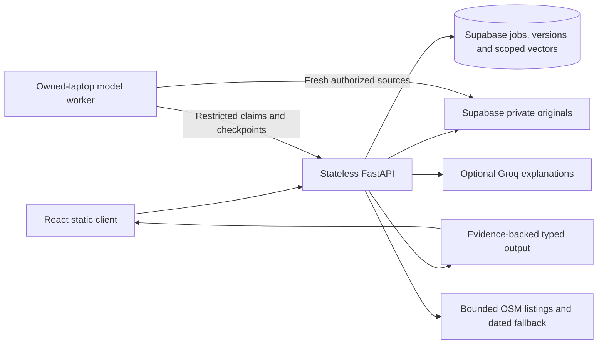

# Architecture and versioned contracts

The implemented application uses React, a stateless FastAPI API and Supabase for trusted login, PostgreSQL and private originals. An outbound native worker runs pinned open-weight models on the owned laptop. Optional Groq explanations and public OSM context enrich saved assessments; their failures do not discard core results. Public hosting remains unverified. See [current evidence](FINAL_IMPLEMENTATION_SUMMARY.md).

## Contract source of truth

`apps/api/app/contracts/models.py` defines schema-v1 field states, language provenance, text/PDF/audio evidence, structured facts, strict ratings, score summaries, assessments, submissions, job states, fenced stage claims, reviews and clarifications. Pydantic forbids extra fields. Present facts need values/evidence; unresolved fields retain nulls. Alternatives preserve ambiguity. Evidence carries submission/revision identity; assessment validation rejects unknown/duplicate/cross-submission references. Page coordinates are normalized and audio/character ranges ordered; actual source-length/duration authorization is additionally enforced by later resource/pipeline boundaries.

The live schema catalog is built by `contracts/schema.py`; `scripts/export_openapi.py` emits the same catalog. `openapi-typescript` generates `apps/web/src/api/generated/schema.ts`. Generated files are checked in; do not edit them by hand. When routes are added, regenerate and review breaking changes. No feature endpoint is fabricated merely to include an unused contract in OpenAPI.

Canonical business facts omit beneficiary identity/demographics. Location is approximate until confirmed; a PIN is not an exact coordinate. Additional technical questions remain evidence-linked facts. Money preserves amount/currency/period/unit; unknown currency or period remains explicit. The server computes totals from ratings; a model never supplies authoritative final arithmetic.

## Processing and access boundaries

API routes authorize each submission/attachment/job/evidence/report/similarity/aggregate boundary. Private storage keeps intact originals; Postgres stores revisions, evidence, stage leases and publication keys. A monotonically increasing claim generation fences stale workers. Owned model code receives restricted capabilities, not unrestricted database credentials. URLs are issued after a successful claim and can be renewed after bounded queue delays. Jobs are resumable; free service sleep does not create an always-on scheduler.

Text/PDF/audio extraction produces exact source segments, followed by local translation, grounded structuring and six rubric dimensions. Deterministic code computes the headline, coverage, completeness and financial checks; model prose cannot change totals. MiniLM embeddings support permission-filtered current-version retrieval. A deterministic fixture proves orchestration/contracts only; actual owned inference is separately measured. Local execution depends on hardware/network uptime; HF is a separate unverified deployment target.

Follow-up revisions reference the parent assessment. The API derives inherited evidence from that exact link and rejects changed or invented ancestry; new text/audio adds new evidence without replacing prior versions. Corrections similarly create a new revision. Trusted transcript verification is tied to an exact source/language revision and never certifies business truth.

Every route checks trusted database roles/cohort assignments as well as RLS. Disposable five-second comparison memoization follows fresh authorization and a live revision fingerprint; it is not authoritative state. Deletion fences active workers and durably tombstones the source before private-object cleanup and derived-record removal. Failed cleanup can resume without exposing the source again. Request bodies, uploads, inference contexts, outputs and provider calls are bounded.

Question translations for five Indic languages are prepared app copy with human review pending. Groq supports user-triggered English/Hindi explanation with schema/citation/numeric guards and a saved-result fallback. OSM uses confirmed coarse areas, shared limits and attribution; empty results are not proof of no competition. Public Nominatim stays disabled by default.

See [RUBRIC.md](RUBRIC.md) for score/eligibility policy and [SOURCES.md](SOURCES.md) for provenance. No publication is authorized by the presence of a build/manifest.
