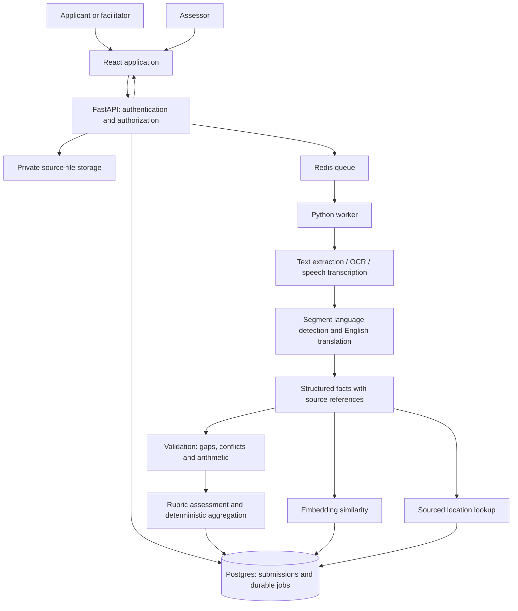

# Udyam Saathi — implementation plan

**Tata STRIVE: AI-Powered Business Idea Screening and Assessment**  
**Execution:** Codex follows 26 ordered tasks; the hackathon window remains 30 hours.  
**Status:** planning deliverable; application implementation and deployment have not started.  
**Prepared and revised:** 17 October 2026

**Execution entry point:** [CODEX_EXECUTION_PLAN.md](CODEX_EXECUTION_PLAN.md). This file is the product/architecture specification; task order and completion reporting are defined in the execution plan and [IMPLEMENTATION_TASKS.md](IMPLEMENTATION_TASKS.md). Earlier human assignments and estimates are superseded.

> Product promise: Turn a regional-language business idea into an evidence-backed assessment, then help the entrepreneur supply the missing information.

## 1. What the uploaded material actually requires

The three-page problem statement asks for a first-line screening tool for entrepreneurship assessors. It explicitly requires text, audio and PDF input; language detection and English translation; preserved originals; structured business details; reasoned ratings; similar submissions; local competition context; and domain, trade, cohort and across-cohort comparisons.

The product supports assessor judgment about deeper evaluation, mentoring, skilling and potential funding consideration. It should not automatically approve or reject applicants for funding.

### Dataset audit

| Uploaded archive | Files | Language folders | Significant cases |
|---|---:|---|---|
| Form fill-ups | 23 PDFs | English 6, Hindi 5, Marathi 6, Telugu 6 | Missing questions, missing answers, irrelevant answers, changed questions, mixed-language answers |
| PDFs | 19 PDFs | English 5, Hindi 4, Marathi 5, Telugu 5 | Complete, incomplete, irrelevant, mixed-language and overwritten responses |
| Audios | 13 recordings | Hindi 2, Bengali 2, Odia 5, Telugu 4 | 11 MP4 containers and 2 OGG files; require audio inspection/transcription |
| **Total submission files** | **55** | **Six languages including English** | **42 PDFs + 13 recordings** |

Findings that affect implementation:

- All 42 PDFs were checked for page count and extractable text. Four Hindi PDFs each contain 11 scanned pages with no text layer. The first page inspected visually contains handwriting. OCR/visual extraction is mandatory.
- The other 38 PDFs have a text layer, but presence of text does not guarantee correct extraction. One English form contains broken characters in a Marathi answer. Add a text-quality check.
- The English overwritten example contains competing prices, revenue estimates and locations. Do not silently choose whichever value appears last in extracted text.
- English examples include tiffin service, tailoring, a tea stall, dairy, beauty services, mobile repair and poultry. Several examples repeat an identity or business with altered answers; these are scenario variants, not necessarily independent entrepreneurs.
- No separate scoring labels, cohort roster, authoritative trade taxonomy or local business directory was found in the supplied archives. Do not invent these as supplied ground truth.
- Recordings were inventoried, not listened to or transcribed during planning. Language counts above use folder labels, which must be checked against content.
- Normalize `Telegu` to `Telugu` and trailing spaces in folder names in the importer, while retaining the original archive path.

Use this small dataset as a development/evaluation corpus. Do not spend the hackathon training or fine-tuning a model. The machine-readable inventory is [dataset-inventory.json](dataset-inventory.json).

## 2. Product scope and user journeys

### Required release: all problem-statement capabilities

1. **Submit:** applicant or field facilitator enters text, records/uploads audio, or uploads a PDF; chooses preferred language and confirms available location/cohort details.
2. **Understand:** preserve the source, extract/transcribe, detect language per segment, translate to English, and construct a business record with evidence references.
3. **Assess:** show domain ratings, reasons, strengths, unanswered questions, conflicts and risks. Separate information completeness from business potential.
4. **Compare:** retrieve similar ideas; filter by trade and cohort; compare cohorts using the same rubric version.
5. **Contextualize:** show sourced local business results when location is sufficiently precise, or a clear unavailable/ambiguous state.
6. **Review:** assessor opens source evidence, corrects extracted fields, records an outcome and exports a concise report. Corrections create a revision.

### Screen plan

| Screen | Contents | Essential interaction |
|---|---|---|
| Submit idea | Text/audio/PDF tabs; language; business location; consent; cohort if known | Upload/record, submit, see durable progress and retry instructions |
| My submissions | Processing state, assessment availability, clarification requests | Applicant can access only their submissions |
| Assessment workspace | Original and English view; business summary; seven domain cards; gaps; similar ideas; nearby businesses | Click evidence to open its PDF page, text span or audio timestamp |
| Assessor queue | Search, trade/cohort/language filters, review status, missing-data indicator | Prioritize clarification and review; record reasoned reviewer action |
| Program dashboard | Domain results, trade comparisons, cohort and across-cohort charts | Display group sizes, evidence coverage, rubric version and exclusions |

Use a responsive layout, readable regional-script fonts, clear keyboard focus and textual chart summaries. Start with an English assessor interface and a language selector for applicant instructions and clarification text. Do not promise that every interface string is translated within 30 hours.

## 3. Features that can distinguish the demo

| Feature | Concrete behavior | Priority and limit |
|---|---|---|
| **Evidence-linked assessment** | Every extracted fact and rating reason links to an original page/quote/audio segment; unreadable or conflicting evidence is visibly flagged | Required; this is the main trust feature |
| **Clarify and improve** | Ask at most three questions in the preferred language, prioritized by critical missing/conflicting fields. Applicant answers in text or audio; show version 1 versus version 2 | Included in T17 after the core assessment flow works |
| **Business arithmetic check** | Check price × daily quantity × operating days and investment = own funds + requested loan; distinguish revenue from profit | Included in T18; deterministic calculations only |
| **Peer collaboration suggestion** | Explain possible shared sourcing or mentoring opportunities between similar ideas | Stretch; assessor-only suggestion, no automated outreach or applicant details shared |
| **Read-aloud feedback / what-if simulator** | Read feedback aloud or vary explicitly supplied cost assumptions | Post-hackathon; do not start before release gates pass |

Example demo: a tea-stall submission states 120 items/day × ₹10 × 25 days = ₹30,000 monthly revenue. Show the arithmetic, then identify that costs are missing, ask about them, and update the feasibility explanation. Never describe ₹30,000 as profit.

A more complete answer can improve confidence or change a rating in either direction. The follow-up flow must not promise a higher score.

## 4. Stack and deployment choice

Keep one Python application with a background worker, one React frontend, and managed persistence. Avoid adding microservices, a general chatbot or an autonomous agent framework.

| Layer | Selected approach | Reason |
|---|---|---|
| Frontend | React + TypeScript + Vite; Tailwind; a small chart library | Fast implementation of a dashboard and mobile-friendly input |
| API | FastAPI + Pydantic | Shared validated contracts, file handling and Python AI tooling |
| Background jobs | Celery + Redis-compatible broker | Long scans/audio survive HTTP request boundaries and worker restarts |
| Database/auth/storage | Supabase Postgres, Auth, private Storage; pgvector | One managed service for identities, durable records, files and similarity |
| PDF parsing | pypdf + pdfplumber; pypdfium2 page rendering | Extract text/layout first; render only suspect/scanned pages |
| Audio | FFmpeg/ffprobe + Sarvam speech-to-text API | Handle the supplied MP4/OGG files and regional-language speech |
| Extraction/translation/rating | Hosted stable Gemini Flash model through a provider adapter | Start with one multimodal provider and schema-constrained output |
| Embeddings | `sentence-transformers/all-MiniLM-L6-v2` on normalized English fields | Small CPU model; keep each input inside tokenizer limit |
| Local business context | Google Places Text Search (New), list display with required attribution | Sourced nearby-business information without building a directory |
| Hosting | Render static frontend + Docker API + Docker worker + Key Value; Supabase persistence | Explicit worker support and reproducible deployment |
| Verification | pytest, a small Playwright smoke suite, CI build and migration checks | Check the critical behavior and release path |

These are implementation choices, not organizer mandates. Use compatible stable dependency versions and commit lockfiles at kickoff.

Provider notes, checked against official documentation:

- Sarvam documents Hindi, Telugu, Bengali and Odia support and timestamped transcription. Use an explicit supported model ID and validate it on the supplied audio. Preserve original-language transcription before English translation. See [speech-to-text reference](https://docs.sarvam.ai/api-reference/speech-to-text/transcribe).
- Gemini supports [PDF understanding](https://ai.google.dev/gemini-api/docs/document-processing) and [structured output](https://ai.google.dev/gemini-api/docs/structured-output). Choose an accessible stable Flash model from the [current model catalog](https://ai.google.dev/gemini-api/docs/models), pin its ID in configuration and verify the exact request during the relevant provider task. Schema validity does not prove factual accuracy.
- The brief permits open-source LLMs **or** optimal/scalable models. The selected hackathon path uses hosted models. If open weights become mandatory, benchmark [Qwen3-8B](https://huggingface.co/Qwen/Qwen3-8B) for English structured assessment on a separate inference service; it is a text model and does not replace OCR or speech transcription. This alternative is outside the 30-hour default scope.
- MiniLM produces sentence/paragraph embeddings and truncates beyond 256 word pieces. Embed bounded business/product/customer fields, then combine normalized vectors; record the model revision. See the [model card](https://huggingface.co/sentence-transformers/all-MiniLM-L6-v2).
- Supabase supports [pgvector](https://supabase.com/docs/guides/ai/vector-columns), [row-level security](https://supabase.com/docs/guides/database/postgres/row-level-security) and [storage access policies](https://supabase.com/docs/guides/storage/security/access-control). Render supports [background workers](https://render.com/docs/background-workers) and [Docker deployment](https://render.com/docs/docker).

Codex is the implementation executor. Budget and configure the app's runtime API credentials and hosting independently; do not assume the coding subscription supplies deployed-app inference access.

## 5. Architecture and processing behavior

### Pipeline rules

1. Validate MIME/signature, size, PDF page count and audio duration. Initial application limits: 25 MB, 20 PDF pages and 10 audio minutes; make limits configurable. The 11-page scans must be accepted. Inspect actual recording durations during T01; adjust limits or split oversized files transparently.
2. Store the original privately and create a durable submission, input revision and job record. Scope content hashes and deduplication to the authorized user/submission; never reveal that another person uploaded an identical file.
3. Text PDFs use layout-aware extraction. Check empty text, replacement/null characters, broken question/answer ordering and suspicious overlap. Render scanned or suspect pages for visual extraction. Preserve both original text and image-derived alternatives where they conflict.
4. Extract audio from MP4/OGG using FFmpeg; transcribe in the source language with timestamps. Segment long recordings at sensible boundaries, preserving offsets and de-duplicating overlap.
5. Translate by answer/segment, not by one assumed language for the file. Preserve numerals, currency, units, place names and original source links. Flag uncertain translations.
6. Map questions semantically rather than relying on question number: the corpus explicitly changes or omits questions. Classify each field as `present`, `missing`, `irrelevant`, `ambiguous` or `unreadable`; record conflicts separately. Unknown values remain null.
7. Extract facts and assess them in separate calls. Validate all outputs with Pydantic, check evidence IDs against source segments, bound ratings and repair malformed output once. An invalid second output becomes a reviewable stage failure.
8. Run similarity and local lookup from the validated business record. Their failure must not erase the core assessment; show the unavailable stage and allow retry.
9. Save immutable assessment versions with input hash, model ID, prompt/rubric/schema versions, timing and measured usage. Reviewer corrections invalidate derived results and create a new version.

Persist stage progress: `queued → extracting → translating → structuring → assessing → enriching → completed`. Include `partial`, `needs_review`, `failed` and `cancelled` outcomes. Use browser polling initially; refresh/reconnect must recover the current state.

Jobs must be idempotent per input revision and pipeline version. Use a database uniqueness constraint, stage checkpoints, finite retries with backoff and a periodic reconciliation pass for queued/stale jobs. The queue is delivery infrastructure; the database is the source of truth. A duplicate delivery must not publish a duplicate assessment.

## 6. Structured data and API contract

### Canonical business record

Store business summary; sector/domain and trade; products/services; target customers; customer problem; location and location precision; research claims; raw materials; suppliers; investment, self-investment and loan; pricing and units; revenue and period; expenses/profit when supplied; competition claims; differentiation; existing-business status; source languages; and field-quality flags.

Every factual field includes `value`, `status`, `source_segment_ids` and optional `alternatives`. A source segment includes its file/revision, original text, English translation and page/bounding box or audio time range. Page-only references are acceptable when reliable boxes are unavailable. Do not fabricate precise coordinates or timestamps.

### Tables

| Table | Purpose |
|---|---|
| `profiles`, `cohorts`, `cohort_memberships` | Role, program membership and authorized access; trusted assignment of reviewer/admin roles |
| `submissions`, `submission_versions`, `attachments` | Owner, assigned cohort, original inputs, hashes and private storage paths |
| `source_segments`, `business_records` | Original/translated evidence and structured field values |
| `processing_jobs`, `job_stages` | Durable state, attempts, leases, progress and stage errors |
| `assessments`, `domain_ratings` | Versioned ratings, reasons, evidence coverage and provenance |
| `idea_embeddings` | One comparable revision per idea; model ID and vector |
| `location_queries` | Source, query context, allowed provider identifiers, timestamps and availability; provider payload retention governed by its terms |
| `clarifications`, `review_actions`, `audit_events` | Follow-up responses, human decisions and correction history |

Keep beneficiary identity outside the scoring payload. Names, phone numbers, gender, social category and educational attainment are not scoring features. Business customer demographics may be relevant facts, distinct from the applicant's demographic characteristics.

### Routes to freeze before splitting work

| Route | Contract |
|---|---|
| `POST /v1/uploads` | Validate request; return restricted upload target/token and attachment ID |
| `POST /v1/submissions` | Accept text/attachment IDs, preferred language and known metadata; return 202 with submission/job IDs |
| `GET /v1/submissions` | Paginated, role-scoped list with filters |
| `GET /v1/submissions/{id}` | Authorized current record, status and assessment version |
| `GET /v1/jobs/{id}` | Stage status, progress and actionable error |
| `GET /v1/submissions/{id}/evidence/{segment_id}` | Authorized source view or short-lived private-file URL |
| `GET /v1/submissions/{id}/similar` | Authorized related ideas, match reasons and retrieval metadata |
| `GET /v1/submissions/{id}/location-insights` | Provider-attributed results or explicit unavailable/ambiguous state |
| `POST /v1/submissions/{id}/clarifications` | Append answer to selected question IDs, create revision and return job ID |
| `POST /v1/submissions/{id}/reviews` | Reviewer-only corrections/outcome/reason with expected revision |
| `GET /v1/analytics` | Domain, trade, cohort and across-cohort aggregates with sample counts and versions |
| `GET /v1/submissions/{id}/report` | Authorized versioned HTML report; browser print-to-PDF for release |
| `GET /health/live`, `GET /health/ready` | Process liveness and required infrastructure readiness |

All failures use `{code, message, retryable, request_id}`. Use generated TypeScript types from the agreed OpenAPI schema. Test that users cannot attach another user's upload or query another user's job/evidence/report by ID.

## 7. Explainable rating design

The organizer supplies assessment dimensions but no official formula. The following is a **proposed rubric v1**, requiring stakeholder calibration after the hackathon.

| Assessment domain | Business-potential weight | What the assessor sees |
|---|---:|---|
| Business clarity | 15 | Whether the offer and operating model are understandable; grammar/accent never reduce it |
| Customer need | 20 | Specific customer problem and evidence of demand |
| Market potential | 20 | Plausible reachable market and research evidence; no invented market size |
| Feasibility | 25 | Resources, skills required by the business, suppliers, investment and internally consistent economics |
| Competition | 10 | Awareness of alternatives and a credible response; provider coverage limits shown |
| Differentiation | 10 | Meaningful service, price, access or product distinction |
| Information completeness | Separate 0–100 | Coverage of relevant business facts, displayed alongside potential |

Rate each of the first six dimensions from 0 to 4: 0 = evidence of a serious weakness; 1 = weakly supported; 2 = plausible but limited; 3 = well supported; 4 = strongly supported with concrete validation. Missing/unreadable/conflicting evidence is **null**, not zero. Label applicant claims as self-reported even when they are specific. Write a domain-specific anchor sheet before implementing prompts.

For assessable domains A:

`provisional_potential = 100 × sum(weight[d] × rating[d] / 4 for d in A) / sum(weight[d] for d in A)`

`evidence_coverage = sum(weight[d] for d in A) / 100`

If no dimensions are assessable, potential is null. Below 70% coverage, or when offer/customer identity is unresolved or important figures conflict, show “Needs clarification” and domain results instead of a headline total. The 70% threshold is an initial product rule to validate, not a scientific confidence measure.

Completeness uses an explicit, versioned applicable-field checklist. Count only relevant, usable answers; missing questions still leave missing fields. Define applicability before looking at scores, and show the denominator. A genuinely inapplicable field may be excluded with a reason; a missing answer may not.

Rank only records with all six potential dimensions assessable, no unresolved critical conflict and the same rubric version. Show incomplete/provisional records in a separate review queue. Do not compare partial totals with different denominators. Small groups get descriptive values and sample counts, not claims of statistical significance.

Domain-wise means assessment dimensions in this plan; also provide sector filtering because “domain” could mean industry in organizer terminology. Trade-wise comparisons use a controlled trade label. Across-cohort charts show within-trade views and cohort composition, so a cohort with different trades is not presented as inherently better.

## 8. Similarity and local context

**Similar ideas:** embed normalized English offer/customer/problem summaries without names or phone numbers. Retrieve top 5 with pgvector cosine distance and show shared products/customers/trade plus differences. Similarity is not plagiarism or proof of competition. Exclude the same submission's revisions. Keep repeated scenario families out of population counts unless explicitly displayed as test data. Calibrate retrieval on annotated relevant/unrelated pairs; do not label raw cosine scores as a probability.

**Nearby businesses:** use confirmed locality/district/PIN and category to query [Places Text Search](https://developers.google.com/maps/documentation/places/web-service/text-search). Show provider attribution, query area and time, category relevance and location precision. A PIN/locality centroid is approximate; do not manufacture an exact operating address. Ask for clarification when locations are ambiguous. Empty listings mean “no results from this source,” not “no competition.”

Use a list rather than a map for the hackathon. Follow the [Places display and retention rules](https://developers.google.com/maps/documentation/places/web-service/policies): preserve permitted place IDs and query metadata, avoid blanket caching of provider content, and implement required attribution. If a map is added, use the provider-compatible map display. Applicant-stated competitors and externally found businesses remain separately labeled. A failed API request must never turn into an invented local-market assessment.

## 9. Codex execution sequence and reporting

Execute the ordered backlog in [IMPLEMENTATION_TASKS.md](IMPLEMENTATION_TASKS.md), following [CODEX_EXECUTION_PLAN.md](CODEX_EXECUTION_PLAN.md). This is an implementation sequence for Codex, not a division of work among people.

| Tasks | Implementation milestone | Observable exit condition |
|---|---|---|
| T01-T03 | Dataset, scaffold and contracts | Reproducible inventory/build and typed API/rubric specification |
| T04-T08 | Persistent, authorized submission flow | Private uploads, durable jobs and applicant UI work across restarts |
| T09-T13 | Multilingual processing and assessment | Text/PDF/audio become evidence-backed, reviewable assessments |
| T14-T16 | Context and comparisons | Similarity, actual local-business lookup and all four comparison views work |
| T17-T19 | Distinctive features and reports | Clarification/reassessment, arithmetic checks and versioned report export work |
| T20-T22 | Quality, access and scaling | Recorded dataset metrics, security checks and multi-instance load/recovery evidence |
| T23-T25 | Deployability and real release | Reproducible packaging, actual HTTPS deployment and deployed acceptance pass |
| T26 | Final handover | Requirements-to-evidence mapping and honest readiness report |

After each task, Codex writes `planning/task-reports/TXX.md` using the report template, records actual changes and checks, then updates [TASK_STATUS.md](TASK_STATUS.md) and the CSV. Only then may the task be marked done. All tasks are initially pending. Reports must be written during implementation, not pre-filled with expected success.

The 30-hour constraint should guide simplicity: use one modular backend, basic charts, list-based local context and browser print-to-PDF. Keep read-aloud, full maps, peer matching and self-hosted LLM deployment outside this execution scope. Clarification and arithmetic are explicitly included tasks. Do not silently remove committed requirements to fit the clock.

Scalability is verified in T22 using two API replicas, two workers, 10,000 synthetic metadata records, a queued-job recovery workload and a concurrent metadata/status workload. The execution plan defines measurement gates. These are planned tests, not achieved capacity claims. T23 verifies deployment packaging; T24 verifies a real public deployment. Missing provider/hosting access remains a named blocker, not a completed integration.

## 10. Evaluation and deployment gates

Create human-reviewed expected outputs before tuning prompts. Group repeated/translated versions of the same base idea into a single family and keep the family on one side of the development/holdout split. Folder labels describe intended scenarios, not authoritative truth for every field. Qualified fluent reviewers must validate relevant languages; automated translation alone is not ground truth. If unavailable, report that language as not yet human-validated.

Targets below are goals to measure, not achieved results:

| Check | Proposed release target |
|---|---|
| Corpus handling | All 55 files reach a usable result, explicit needs-review state or actionable failure; no silent drops; report success/review/failure counts separately |
| Core field extraction | ≥90% accuracy on manually annotated readable fields; report numerator/denominator by language, format and difficulty |
| Missing/irrelevant/conflicting answers | Precision and recall ≥0.85 on annotated field-status labels; publish per-class counts |
| Critical numbers | Every annotated critical price/investment/revenue value is correct with units/period or explicitly flagged uncertain |
| Traceability | Every displayed rating has valid evidence references or an explicit insufficient-evidence explanation |
| Similarity | Recall@5 ≥0.8 on human-labeled positive pairs; include hard negatives and report pair count |
| Rating consistency | On held-out reviewer-rated ideas, report per-domain agreement and disagreements; repeat 10 records three times and flag unstable outputs |
| Language fairness | Compare matched, human-verified equivalents; investigate >5/100 potential-score difference and coverage mismatches; small sample is not proof of fairness |
| Responsiveness | Submission acknowledgment p95 <2 s after upload; text/short digital PDF p95 <45 s; ≤2-minute audio p95 <90 s; 11-page scans p95 <180 s under a documented 3-job load |
| Reliability/access | Restarted jobs resume without duplicate results; failed providers surface errors; cross-user and cross-cohort unauthorized access is denied |

Speech evaluation should include business field accuracy and a manually transcribed subset for word/character error reporting. Measure queue wait separately from processing time. Do not claim “real time” for long scanned documents; show stage progress.

For deployment instructions, secrets, failure recovery and handover criteria see [DEPLOYMENT_CHECKLIST.md](DEPLOYMENT_CHECKLIST.md). Production readiness requires the tests to pass on the deployed environment, not merely a Dockerfile or successful localhost demo.

## 11. Five-minute judging demo

1. **0:00–0:35:** Explain the assessor workload and show the six-language, three-format input options.
2. **0:35–1:25:** Submit a short regional recording live; show transcription, English structure and progress. Have a clearly labeled preprocessed example available if latency exceeds the slot.
3. **1:25–2:10:** Open a rating's source evidence, then show an overwritten/missing-answer example that correctly requests review.
4. **2:10–3:00:** Answer a clarification; show what changed and why. Demonstrate revenue versus profit only if the arithmetic extra is complete.
5. **3:00–3:50:** Show similar ideas and sourced local businesses with coverage limitations.
6. **3:50–4:30:** Show domain, trade, cohort and across-cohort views. Label synthetic cohorts and scenario variants clearly.
7. **4:30–5:00:** Show the deployed URL, report export, measured evaluation counts and recovery/latency results.

Closing message for the pitch: “We help assessors understand the idea, check the evidence and ask the next useful question—while preserving the entrepreneur's own words.”
